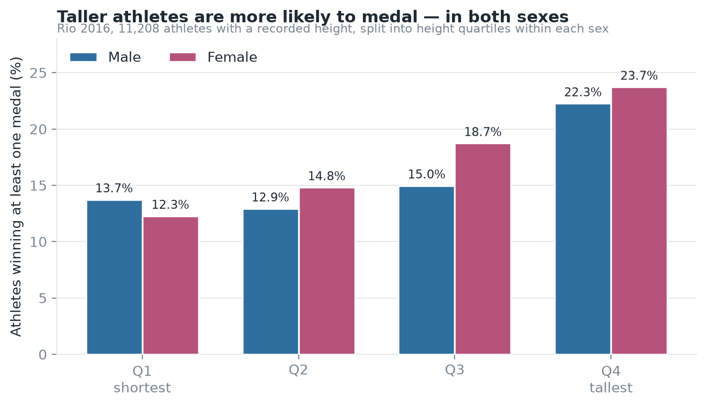
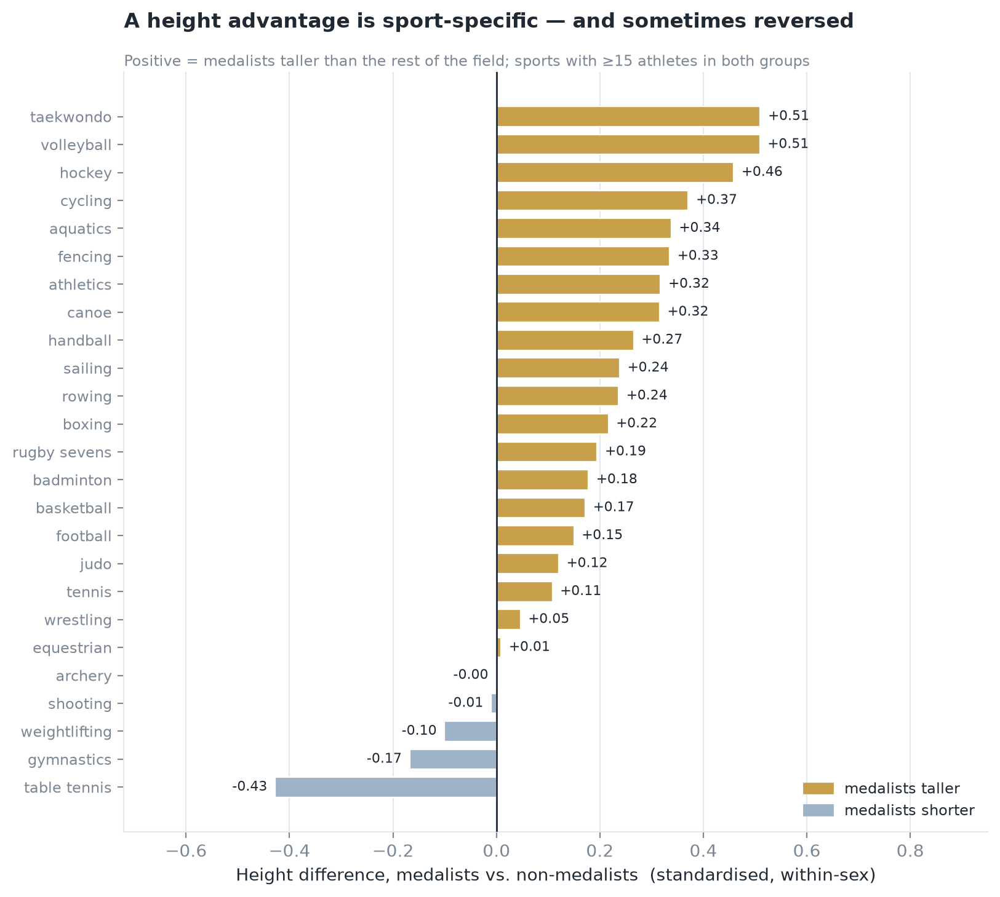
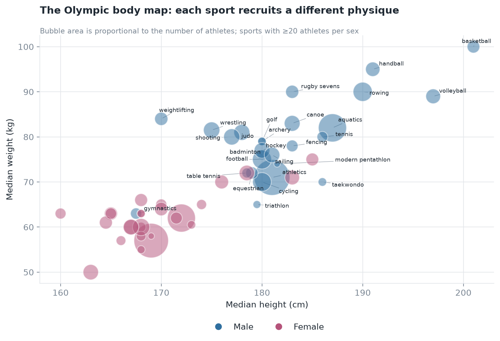

  <header class="hero">
    
Data Science Portfolio

    <h1>Chen Junyang</h1>
    

      Data science student at the University of Macau. I turn messy public datasets into
      clear, defensible answers — and I care as much about <em>why</em> a number is true
      as about the number itself.
    

    <ul class="chips">
      <li>Python</li>
      <li>pandas · NumPy</li>
      <li>Matplotlib · seaborn</li>
      <li>Jupyter</li>
      <li>Exploratory data analysis</li>
      <li>Data visualisation</li>
      <li>Git · GitHub Pages</li>
    </ul>
  </header>

  <section class="about">
    <h2>About</h2>
    

      I work mostly in Python: cleaning a dataset until it can be trusted, then testing a
      question against it instead of assuming the answer. My current focus is exploratory
      analysis and visual storytelling — building charts that make a finding obvious in one
      glance, and writing down the caveats that a single summary statistic would hide.
    

    

      This page is my portfolio: each entry below links to a public repository with the
      data, the code and a README detailed enough that someone else can reproduce the
      results from a clean machine.
    

  </section>

  <section class="project">
    

      

        
Project 01

        <h2>Does body size predict Olympic success?</h2>
        
Rio 2016 · 11,538 athletes · 28 sports · Python, pandas, Matplotlib

      

      Completed
    

    

      
Research question

      

        Were Rio 2016 medalists systematically taller and heavier than athletes who did not
        medal — and is that advantage the same in every sport?
      

    

    <figure>
      
      <figcaption>
        Medal rate by height quartile, computed within each sex. Rio 2016, 11,208 athletes
        with a recorded height.
      </figcaption>
    </figure>

    
What the data shows

    <ul class="findings">
      <li>
        <strong>Size helps on average.</strong> The tallest quartile of athletes medals
        <strong>1.6×</strong> as often as the shortest among men (22.3% vs 13.7%) and
        <strong>1.9×</strong> as often among women (23.7% vs 12.3%).
      </li>
      <li>
        <strong>But the advantage is sport-specific.</strong> Standardised height differences
        between medalists and non-medalists range from <strong>−0.43</strong> in table tennis
        to <strong>+0.51</strong> in volleyball and taekwondo — the same body type that wins
        one sport loses another.
      </li>
      <li>
        <strong>Where mass is regulated, height stops mattering.</strong> Weightlifting
        (−0.10) and wrestling (+0.05) sit near zero: inside a weight class, extra height buys
        nothing.
      </li>
    </ul>

    

      <figure>
        
        <figcaption>
          Height difference between medalists and non-medalists, per sport (Cohen's d on
          within-sex z-scores).
        </figcaption>
      </figure>
      <figure>
        
        <figcaption>
          The Olympic body map: median height vs. median weight per sport and sex, bubble area
          proportional to athlete count.
        </figcaption>
      </figure>
    

    

      
Takeaway &amp; one limitation

      

        "Taller athletes win more" is true only as an average. Split by sport, body size is an
        advantage in volleyball and cycling, irrelevant in shooting and archery, and a
        disadvantage in gymnastics and table tennis. The biggest caveat is that every member
        of a medalling squad is counted individually, so team sports show inflated medal
        rates (25% in basketball vs 7.4% in athletics) — part of that effect is squad
        selection, not individual performance.
      

    

    

      <a class="btn" href="https://github.com/mc63609/data-science-project">View the repository</a>
      <a class="btn btn-ghost" href="https://github.com/mc63609/data-science-project/blob/main/notebooks/rio2016_body_size_analysis.ipynb">Open the notebook</a>
    

  </section>

  <section class="next">
    <h2>What I would do next</h2>
    

      The current analysis stops at sport level. The next iteration would use event-level data
      (100 m vs. shot put), fit a logistic regression of medalling on height, weight, age and
      sport fixed effects, and re-run everything on individual sports only as a robustness
      check on the team-sport inflation.
    

  </section>

  <footer>
    
Chen Junyang · CISC7204 Data Science Portfolio · University of Macau

    
<a href="https://github.com/mc63609">github.com/mc63609</a>

  </footer>

